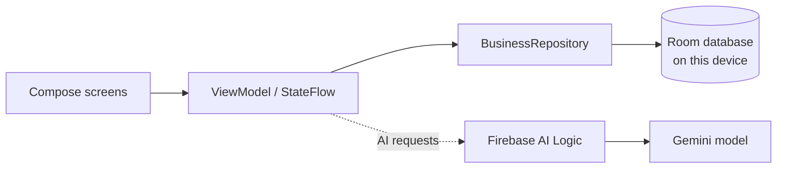

<p align="center">
  
</p>

<p align="center">
  <a href="https://github.com/anhyun105/merchspring-ai/actions/workflows/android-ci.yml"></a>
  
  
  
  
</p>

<p align="center">
  <a href="https://github.com/anhyun105/merchspring-ai/actions/workflows/android-ci.yml">Builds & test APK</a> ·
  <a href="docs/TESTING.md">Tester guide</a> ·
  <a href="docs/PRODUCTION_READINESS.md">Readiness checklist</a> ·
  <a href="SECURITY.md">Security policy</a>
</p>

> [!IMPORTANT]
> **MerchSpring AI is an early-stage prototype, not a production accounting or tax system.** Do not use it as the source of truth for real customer balances, tax filings, payment reconciliation, or multi-branch stock. Review the [production-readiness checklist](docs/PRODUCTION_READINESS.md).

## What is MerchSpring AI?

MerchSpring AI is a native Android business-management prototype for small retailers, shops, wholesalers, and growing businesses. It brings everyday inventory and operations workflows into one interface, with an optional AI assistant for business questions and carefully validated action proposals.

## What you can explore

| Area | Included in the prototype |
| --- | --- |
| **Products & inventory** | Product catalogue, stock adjustments, stock movements, reorder recommendations, and transfer concepts |
| **Sales & POS** | Quick billing, sales orders, dispatch, customer records, and return workflow |
| **Purchasing** | Purchase orders, supplier records, goods receiving, and purchase-payment tracking |
| **Operations** | Expenses, cash-closing workflow, notifications, reports, and business metrics |
| **AI assistant** | Contextual business Q&A, confirmed action proposals, and optional Google Search grounding with source attribution |
| **Invoice preview** | Draft preview using configured business/product details; not a verified GST invoice |
| **Workspace** | Local settings, branch concepts, and an explicit option to load fictitious demo data |

The list describes workflows available to explore in the source; it does **not** mean every workflow is production-validated.

## Technology and architecture

- **Kotlin + Jetpack Compose** — native Android UI
- **ViewModel, Coroutines and Flow** — UI state and asynchronous work
- **Room** — on-device business-record persistence
- **Firebase AI Logic** — optional Gemini integration through Firebase
- **Firebase App Check** — debug provider for development and Play Integrity provider for release builds
- **Gradle Kotlin DSL + Gradle Wrapper** — repeatable build setup



**Data boundary:** core business records remain in a local Room database. Firebase AI Logic handles AI requests; it does not add authentication, cloud storage for business records, or cross-device sync.

## Get a test build

The easiest option is to download the debug APK produced by a **successful** GitHub Actions run.

1. Open [Android CI on GitHub Actions](https://github.com/anhyun105/merchspring-ai/actions/workflows/android-ci.yml).
2. Open the latest run with a green check mark.
3. Under **Artifacts**, download `merchspring-ai-debug-apk`.
4. Transfer `app-debug.apk` to an Android device running Android 7.0 / API 24 or newer and install it. Android may ask you to allow installation from the app used to open the APK.
5. CI uses a temporary debug signing key. If Android reports a signing-certificate conflict when replacing an older test APK, uninstall the previous test build and install the new one.

The workflow uploads the APK only if assembly **and** unit tests succeed. Test reports are uploaded separately when available. CI artifacts are temporary test outputs, not a production release.

## Build locally

### Requirements

- JDK **21** (Robolectric tests run against Android API 36)
- Android SDK Platform **36.1**
- Android Build Tools **36.0.0**
- Android Studio compatible with Android Gradle Plugin **9.1.1**
- Internet access for the initial Gradle/dependency download

The included Gradle Wrapper pins Gradle **9.3.1** and verifies its distribution checksum. You do not need a global Gradle installation.

### Build and run tests

```bash
git clone https://github.com/anhyun105/merchspring-ai.git
cd merchspring-ai

# Create a development-only signing key if one is not already present.
if [ ! -f debug.keystore ]; then
  keytool -genkeypair -v \
    -keystore debug.keystore \
    -storepass android \
    -keypass android \
    -alias androiddebugkey \
    -dname "CN=Android Debug,O=MerchSpring AI,C=US" \
    -keyalg RSA -keysize 2048 -validity 10000
fi

./gradlew --version
./gradlew :app:assembleDebug :app:testDebugUnitTest --no-daemon
```

The debug APK is written to `app/build/outputs/apk/debug/app-debug.apk`. Install it on a connected device with Android Debug Bridge:

```bash
adb devices
adb install -r app/build/outputs/apk/debug/app-debug.apk
```

Open the project in Android Studio for code navigation and UI development. Set the Gradle JDK to JDK 21 and install the SDK versions listed above.

## Configure Firebase AI (optional)

Core local workflows can be compiled without Firebase project configuration, but **the AI assistant needs a correctly configured Firebase project**.

1. Register the Android app in Firebase using the current application ID: `com.aistudio.merchspring.kvpnwx`.
2. Enable Firebase AI Logic and configure a Gemini provider/model supported by your project.
3. Place the downloaded `google-services.json` at `app/google-services.json`. This path is intentionally ignored by Git.
4. For debug builds, register the App Check debug token in Firebase Console. For release builds, verify Play Integrity and enforce App Check only after checking the project configuration.
5. Configure quotas and billing alerts, then verify AI behavior and Google Search source attribution in the actual app.

Never commit service-account credentials, App Check debug tokens, production signing keys, private customer data, or a Gemini API key. See [SECURITY.md](SECURITY.md).

## First-run demo

A fresh installation should open with a clean workspace. To explore fictitious records, use **Settings → Reload Demo Data**. Read the confirmation carefully: loading demo data replaces the current workspace records. Do not enter live customer or financial data into a test installation.

Follow the [manual tester guide](docs/TESTING.md) for a repeatable smoke test. Report defects with reproducible steps and sanitised screenshots/logs; never attach actual customer data or credentials.

## Known limitations

- **Local-only records:** no Firebase Authentication, cloud Firestore business-data sync, multi-user login, or cross-device synchronisation.
- **Payment tracking:** records mostly store aggregate paid amounts and a single payment method rather than a dated, append-only receipt ledger.
- **Multiple branches:** branch/transfer flows are prototypes; product stock is global rather than separately accounted for per branch.
- **Returns and exchanges:** replacement-item issuance, complete store-credit accounting, and tax/credit-note treatment are not complete.
- **Invoices and tax:** invoice output is a draft preview. GST compliance, sequential invoice numbering, portal filing, and tax treatment have not been certified.
- **Invoice extraction:** the current extraction screen is a demo fixture, not real OCR.
- **Recovery and upgrades:** encrypted backup/restore and release-grade Room migration strategy still need work.

Review [docs/PRODUCTION_READINESS.md](docs/PRODUCTION_READINESS.md) before treating any workflow as business-critical.

## Repository map

| Path | Purpose |
| --- | --- |
| `app/src/main` | Android application source and resources |
| `app/src/test` | JVM unit and Robolectric tests |
| `app/src/androidTest` | Instrumentation tests for a device/emulator |
| `.github/workflows/android-ci.yml` | Build, tests, reports, and test APK artifact |
| `docs/TESTING.md` | Manual tester smoke-test checklist |
| `docs/PRODUCTION_READINESS.md` | Known gaps and release checklist |
| `CONTRIBUTING.md` | Development and contribution guidance |
| `SECURITY.md` | Security policy |

## Contributing

Bug reports, reproducible test cases, and focused pull requests are welcome. Start with [CONTRIBUTING.md](CONTRIBUTING.md), use the issue templates, and include actual build/test results.

## License

No project license has been selected yet. Until the repository owner adds a license, assume standard copyright applies; do not treat the source as available for unrestricted redistribution or commercial use.

---

<p align="center"><strong>MerchSpring AI</strong> · Your Business, in Sync.</p>
